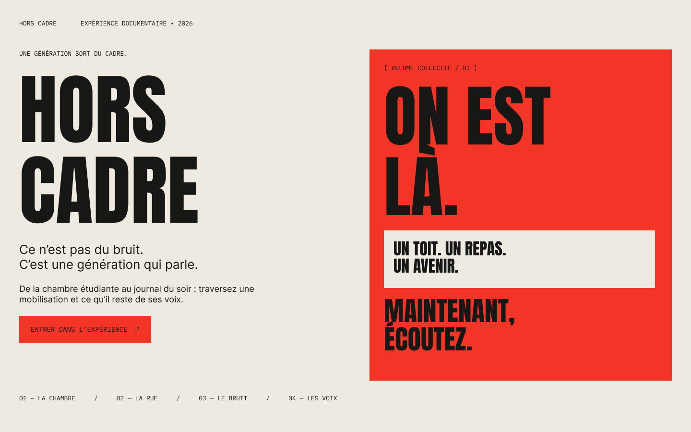

# HORS CADRE

> Ce n’est pas du bruit. C’est une génération qui parle.

Expérience documentaire interactive sur la colère étudiante et sa transformation en bruit médiatique avant même d’être entendue.

## Maquette

[Ouvrir la maquette Figma éditable](https://www.figma.com/design/cuFSnI2KEsFVh3iOarpbw9?node-id=2-10)

Cinq écrans desktop (1440 × 900) et une entrée mobile (390 × 844). Le parcours desktop est relié par des interactions de navigation dans Figma.

## Intention

Partir des réalités du quotidien — logement, alimentation, études, travail — pour rejoindre une mobilisation. Montrer ensuite comment les témoignages et les revendications se fragmentent entre la rue, les réseaux et les médias. L’expérience se termine dans le silence, face aux demandes initiales.

## Parcours

1. **Entrée** : HORS CADRE et invitation à écouter.
2. **Chambre** : frigo presque vide, hausse de loyer, emploi du temps saturé, message de mobilisation.
3. **Rue** : des histoires individuelles derrière la colère collective.
4. **Trois récits** : paroles complètes, extraits viraux et résumé institutionnel.
5. **Silence** : « Après tout ce bruit, qu’avez-vous réellement entendu ? »

## Interactions prévues

- **Faire taire** : effacer la foule et interrompre les sons pour révéler les revendications.
- **Écouter** : laisser le temps à une parole complète, avec une transcription accessible.
- Navigation clavier, lecture sans son, contrôle du volume et respect du mouvement réduit.

## Direction artistique

Noir encre, papier écru et rouge vif. Anton pour les titres, IBM Plex Mono pour les repères, Inter pour les textes. Affiches typographiques et contrastes éditoriaux. La première maquette utilise des compositions originales ; les photographies documentaires seront ajoutées après sélection et vérification des droits.

## Statut et démarche éditoriale

**En conception. Ce dépôt contient le cadrage du projet ; l’expérience web n’est pas encore développée.** Les scènes et paroles de la maquette sont fictives et explicitement indiquées comme telles. Aucun exemple n’est attribué à un média ou à une personne réelle. Les futurs événements et témoignages documentaires devront être sourcés, datés et distingués des reconstitutions, avec l’accord des personnes concernées.

Voir [le parcours et les interactions](docs/parcours.md) et [la charte éditoriale](docs/charte-editoriale.md).
