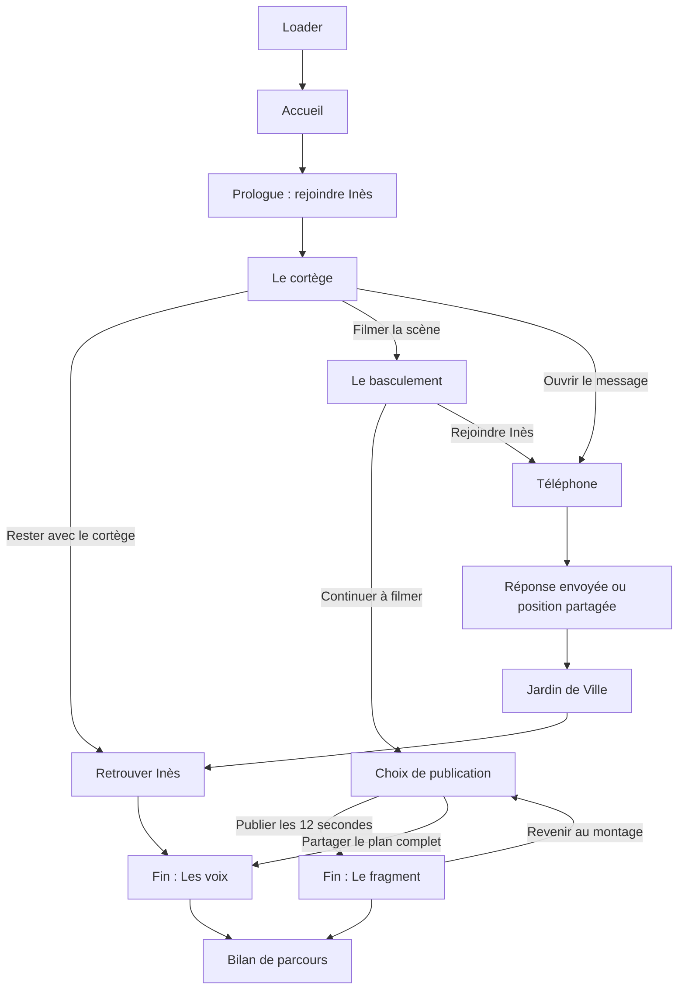

# HORS CADRE — Trame complète & suivi de la maquette

> **Ce n’est pas du bruit. C’est une génération qui parle.**
> HORS CADRE est une fiction documentaire interactive située à Grenoble : vivre une manifestation à hauteur d’étudiant, choisir où regarder, qui rejoindre et ce que l’on partage.
> **Document de travail pour faire avancer la maquette.** Le scénario décrit ci-dessous sépare le prototype existant des développements encore proposés.

## Les trois points d’entrée
- [Maquette Figma — écrans et composants](https://www.figma.com/design/cuFSnI2KEsFVh3iOarpbw9)
- [Prototype — du loader à l’expérience](https://www.figma.com/proto/cuFSnI2KEsFVh3iOarpbw9?node-id=58-32596&starting-point-node-id=58%3A32596)
- [GitHub — Mahkalix / HORS-CADRE](https://github.com/Mahkalix/HORS-CADRE)

**Rôle des outils :** Notion porte le récit, les décisions et les critères de validation ; Figma porte les écrans, les composants et le prototype ; GitHub porte la documentation et accueillera le développement. Ces liens ne constituent pas une synchronisation automatique.

État de référence : 2026-10-20. Vérifié à partir du parcours cliquable Figma et du README GitHub.

## 1. Le projet en une minute
**Question centrale :** comment une colère étudiante réelle devient-elle du bruit médiatique avant même d’être entendue ?

Le joueur ne dirige pas la manifestation. Il incarne un regard situé, avec un téléphone et un entourage étudiant. La nouvelle distribution comprend Gabriel, Salim, Noé, Louve, Irène et Amandla ; le prototype antérieur utilise encore Inès comme interlocutrice provisoire. Il ne peut pas simultanément écouter tout le monde, filmer toute la scène et rester avec son groupe. Ses décisions changent ce qu’il voit, les relations qu’il préserve et le récit qu’il peut ensuite transmettre.

**Promesse :** une expérience immersive à choix cliquables, inspirée de la mise en scène des jeux narratifs et de leur arbre de ramifications, avec des vidéos réelles contextualisées à terme. La cible actuelle affichée sur l’accueil est d’environ dix minutes ; la durée devra être vérifiée avec les médias retenus.

**Cadre :** Grenoble, principalement Victor-Hugo, place Grenette, Jardin de Ville et place de Verdun. Les trajets et la journée racontée sont fictifs ; la carte ne présente pas un itinéraire officiel de manifestation.

**Positionnement :** une œuvre engagée sur la jeunesse, les institutions et la fabrication des images. Montrer les tensions et les violences observables sans présumer de leur auteur ni attribuer une culpabilité à partir d’un extrait isolé.

## 2. Ce qui existe et ce qui reste à concevoir
**Déjà maquetté :** trois états de loader, accueil, prologue, cortège, basculement, carte et lieux, messages et réponse envoyée, retrouvailles avec Inès, choix de publication, deux fins, bilan ramifié, pause et sources, aperçu mobile. Cela représente dix-neuf cadres d’écran, dont trois états du loader.

**Déjà structuré :** composants de navigation, choix et embranchements, messagerie, téléphone, carte, boutons, identité et variantes de logo. Les dix-neuf cadres principaux et leurs blocs de contenu utilisent désormais Auto Layout ; les superpositions visuelles conservent leur positionnement absolu.

**Pas encore réalisé :** film interactif jouable sur le web, vidéos intégrées, bande-son, progression persistante, arbre calculé selon le parcours réel et version mobile complète. Le Figma simule des navigations et le défilement du loader. Le bilan affiche encore un exemple de parcours fixe.

**À retenir :** l’ancien README et les documents historiques du dépôt décrivaient une autre version. Ils ne suffisent pas pour connaître l’état actuel de la maquette.

## 3. Les personnages et le point de vue

**Nouvelle distribution de référence : Gabriel, Salim, Noé, Louve, Irène et Amandla.**

[Fiches complètes des personnages](personnages.md)

### Gabriel, 22 ans — le révolté
Étudiant en histoire, issu d’une famille de classe moyenne. Il a longtemps cru au dialogue, mais considère aujourd’hui que les manifestations pacifiques ne suffisent plus. Il participe parfois aux dégradations.

**Conviction :** « Quand personne ne nous écoute, comment se faire entendre ? »

### Salim, 21 ans — le pacifiste
Étudiant en droit, ayant grandi dans un quartier populaire. Il connaît les discriminations et les tensions avec les institutions, mais refuse la violence. Sa non-violence est un choix politique assumé.

**Conviction :** « Notre colère est légitime. Ce qu’on en fait compte aussi. »

### Noé, 23 ans — l’organisateur
Étudiant en sciences politiques, engagé dans un syndicat étudiant. Il organise les assemblées générales et les cortèges. Il sait que négocier peut apporter des victoires, mais aussi provoquer des compromis difficiles.

**Conviction :** « Une mobilisation sans organisation risque de s’épuiser. »

### Louve, 22 ans — la révoltée
Étudiante en sociologie, issue d’un milieu favorisé. Elle s’est radicalisée politiquement au fil de ses études. Elle remet en question sa propre position sociale et accepte certaines formes d’action directe.

**Conviction :** « Être neutre face à une injustice, c’est déjà faire un choix. »

### Irène, 21 ans — la pacifiste
Étudiante en psychologie, elle manifeste pour la première fois. Elle veut défendre ses droits, mais redoute les affrontements. Elle découvre progressivement que rester pacifique ne suffit pas toujours à éviter la confrontation.

**Conviction :** « On peut être en colère sans vouloir blesser quelqu’un. »

### Amandla, 23 ans — la militante
Étudiante en communication, engagée dans un collectif étudiant. Elle documente les manifestations et fait circuler les témoignages. Elle se demande parfois si filmer une injustice aide réellement les personnes concernées.

**Conviction :** « Ce qu’on ne montre pas risque d’être oublié. »

### Point de vue et adaptation du prototype
Le personnage jouable et les relations entre les six personnes restent à choisir. Aucun de ces rôles n’est automatiquement déclaré jouable.

**Inès est l’interlocutrice provisoire de la maquette antérieure.** Les sections suivantes décrivent encore les écrans existants avec ce prénom afin de rester fidèles au prototype. Pour la prochaine version, répartir ses messages, son rôle affectif et le rendez-vous entre les six personnages ; ne pas ajouter par défaut un septième personnage.

**Portraits :** références visuelles d’ambiance, non définitives. Ils n’attribuent pas les convictions ou actes fictifs aux personnes photographiées. Les liens sont conservés dans les fiches ; droits et identités n’ont pas été vérifiés.

### Intégration proposée
Noé peut porter l’organisation et les rendez-vous ; Amandla, la documentation et le montage ; Gabriel et Louve, deux trajectoires distinctes de rupture ; Salim et Irène, deux rapports différents à la non-violence. Cette répartition est une proposition de scénario à valider, pas une description des écrans déjà réalisés.

## 4. La trame de A à Z
### A — Le seuil : loader puis accueil
**Ce que l’on vit :** avant même d’entrer dans la rue, des mots traversent l’écran : entendre, filmer, rester, choisir, logement, avenir, dignité, écouter.

**Écran :** HORS CADRE en grand, fond beige papier, écriture brun profond. Deux lignes de mots défilent en sens opposés. Le loader peut être passé. Les chiffres actuels sont une simulation graphique ; ils ne mesurent pas le chargement réel de fichiers.

**Accueil :** la signature annonce le sujet et donne accès à l’expérience, à la carte et aux sources. Le libellé du bouton observé est actuellement « CONTINUER » ; pour une première visite, « Entrer dans l’expérience » serait plus clair, tandis que « Continuer » devrait correspondre à une progression enregistrée.

### B — Avant la rue : donner une raison d’être là
**Intention initiale, non maquettée dans le parcours actuel :** une chambre étudiante, un frigo presque vide, une hausse de loyer, des démarches administratives et un agenda cours/travail. Une notification invite à la mobilisation.

Cette scène explique la colère avant le spectacle. Elle reste une option de scénario : soit un court prologue interactif, soit quelques indices intégrés au téléphone. Ne pas l’ajouter automatiquement à la version actuelle tant que sa durée et sa fonction ne sont pas choisies.

### C — Le prologue : rejoindre Inès
**Version existante :** « Tu étais venu·e pour être entendu·e. » Le joueur rejoint Inès dans le cortège, téléphone chargé, sans savoir encore comment il s’en servira.

**Action :** rejoindre Inès → le cortège.

**Fonction :** établir le lien humain et annoncer que chaque choix déplace le regard. L’écran précise que les archives illustrent une fiction.

### D — Le cortège : entendre avant de choisir
**Version existante :** Inès dit : « Tu vois ? On n’est pas là pour rien. » L’objectif est de rester près d’elle. Le joueur choisit ce qui retient son attention :
- **Rester avec le cortège** → écran de retrouvailles avec Inès.
- **Filmer la scène** → basculement.
- **Ouvrir le message** → téléphone et carte.

**À renforcer :** donner d’abord une scène à écouter ou une personne à rencontrer. Aujourd’hui, « Rester avec le cortège » conduit trop vite à « Tu l’as retrouvée » alors que la séparation n’a pas encore été vécue. Une transition est nécessaire ou le libellé de conséquence doit changer.

### E — Le basculement : le groupe se disperse
**Version existante :** un cadre d’enregistrement, douze secondes filmées, le groupe qui se disperse et un message d’Inès : « T’es où ? On s’est perdus. »

Deux actions :
- **Continuer à filmer** → décision de publication.
- **Rejoindre Inès** → téléphone, puis point de rendez-vous.

**Conflit :** garder une trace ou chercher son amie. Le joueur ne doit pas recevoir une explication de la « bonne réponse » avant de choisir.

**À écrire avec les médias :** ce qui déclenche la dispersion, ce que la caméra montre réellement et ce qu’elle ne permet pas de conclure. Les violences de manifestants ou de policiers ne peuvent être écrites comme des faits réels avant la sélection et la vérification des séquences correspondantes.

Le faux compte à rebours a été retiré du desktop ; le texte mobile contient encore « 00:08 » et doit être harmonisé.

### F — Le téléphone : reprendre contact
**Conversation existante :**
1. Inès propose d’abord la place Victor-Hugo.
2. Le joueur répond qu’il sort du tram.
3. Inès annonce que le groupe a avancé vers Grenette et propose le Jardin de Ville si le groupe se perd.
4. Une position partagée ouvre la carte.
5. Deux réponses rapides : « J’arrive ! » et « Restez ensemble ».
6. L’état envoyé confirme : « J’arrive au Jardin de Ville. »

**Fonction :** faire du téléphone un outil du récit, pas un menu décoratif.

**À corriger :** la conversation mélange actuellement des messages antérieurs et l’instant présent. Ajouter des heures ou un séparateur clair. Définir l’effet de chaque réponse, au lieu de proposer deux formulations qui arrivent presque au même résultat.

### G — La carte de Grenoble : retrouver une direction
**Victor-Hugo :** point de départ et repère de la rencontre.
**Grenette :** entrée dans le cortège et les paroles collectives.
**Jardin de Ville :** rendez-vous avec Inès.
**Verdun :** accès actuel à la scène de basculement ; sa place exacte dans la chronologie reste à décider.

La carte est cliquable et s’appuie sur une géométrie OpenStreetMap stylisée. Elle doit aider le joueur à retrouver son objectif, pas lui proposer un tableau de surveillance. Distinguer les lieux visités, accessibles et encore inconnus ; ne pas laisser une navigation libre contredire les événements déjà vécus.

### H — Retrouver Inès : le lien avant l’image
**Version existante :** « Tu l’as retrouvée. Tu n’as pas tout filmé. » Le groupe se reforme à l’écart ; ce qui s’est passé derrière le joueur reste hors de son cadre.

**Action :** continuer ensemble → fin « Les voix ».

**Conséquence :** le lien est préservé, mais le joueur ne dispose pas d’un enregistrement complet. Ce manque doit être ressenti sans devenir une punition.

**À préciser :** cette branche rejoint actuellement la même fin que le partage d’un plan complet. Conserver éventuellement un écran final commun sur les revendications, mais personnaliser le bilan pour ne pas laisser croire que le joueur a filmé ce qu’il n’a pas vu.

### I — Ce que tu montres : choisir un montage
**Version existante :** « 12 secondes. Toute l’histoire ? » Le joueur possède un extrait de douze secondes et un plan complet annoncé de deux minutes trente-quatre.

Deux actions :
- **Publier les 12 secondes** → fin « Le fragment ».
- **Partager le plan complet** → fin « Les voix ».

**À renforcer :** permettre de comparer concrètement les débuts et les fins des deux versions avant de publier. La durée du plan complet reste une donnée fictive de maquette et doit être ajustée aux médias disponibles.

Un plan plus long n’est pas automatiquement neutre ou complet : le cadrage, le point de vue et les informations manquantes doivent rester perceptibles.

### J — Fin 1 : le fragment
L’extrait circule ; la scène est commentée pour son spectacle, les revendications disparaissent derrière les réactions.

**Phrase existante :** « On a vu ton image. Qui a entendu vos voix ? »

**À concevoir :** une montée de commentaires et de reprises médiatiques fictives clairement identifiées. Montrer des transformations concrètes du récit sans inventer un faux article attribué à un vrai média.

**Sorties :** voir le parcours ou revenir au choix de montage.

### K — Fin 2 : les voix
Le rythme redescend. Les demandes réapparaissent : un logement digne, étudier sans s’épuiser, être représenté et pouvoir envisager la suite.

**Phrase existante :** « Derrière le bruit, il y avait des demandes. »

**Convergence proposée :** personnaliser l’entrée de cette fin selon que le joueur a retrouvé Inès ou partagé son plan, puis conserver une restitution commune des revendications.

La formulation d’origine « Après tout ce bruit, qu’avez-vous réellement entendu ? » peut servir de dernière question ; elle n’est pas encore matérialisée comme interaction finale.

### L — Après le film : voir ce qui est resté hors cadre
L’arbre inspiré des jeux narratifs révèle les étapes suivies, les autres possibilités et les passages non explorés. Crochets ouverts, connecteurs fins et vignettes sur les fins reprennent la direction des références.

**Existant :** nœuds cliquables pour rejouer des étapes, chemin bleu et branches discrètes.
**À développer :** alimenter l’arbre avec le vrai parcours du joueur ; décider quand les scènes inconnues peuvent être révélées ; définir ce qui est réinitialisé quand on rejoue une étape.

### M — Pause, sources et sortie
Pause, sous-titres, transcription, son, mouvement réduit et reprise de scène doivent rester accessibles sans compter comme des décisions narratives.

**Existant :** page pause et sources. Le bouton de reprise revient actuellement au basculement, indépendamment de l’écran d’origine.
**À corriger :** reprendre à la scène et au moment réellement quittés.

## 5. Carte des embranchements existants

Ce schéma décrit le parcours principal ; la carte, la pause, les sources et certains raccourcis de navigation donnent aussi accès à d’autres écrans. Il ne représente pas encore un moteur narratif avec prérequis.

## 6. Les écrans à ouvrir pendant la conception
| Écran | Figma | Travail prioritaire |
| --- | --- | --- |
| Loader | [Ouvrir](https://www.figma.com/design/cuFSnI2KEsFVh3iOarpbw9?node-id=58-32596) | Distinguer animation d’attente et véritable chargement ; mouvement réduit. |
| Accueil | [Ouvrir](https://www.figma.com/design/cuFSnI2KEsFVh3iOarpbw9?node-id=26-38621) | Clarifier commencer ou reprendre. |
| Prologue | [Ouvrir](https://www.figma.com/design/cuFSnI2KEsFVh3iOarpbw9?node-id=8-370) | Choisir la place du quotidien étudiant. |
| Cortège | [Ouvrir](https://www.figma.com/design/cuFSnI2KEsFVh3iOarpbw9?node-id=8-388) | Faire entendre des motivations avant le choix. |
| Basculement | [Ouvrir](https://www.figma.com/design/cuFSnI2KEsFVh3iOarpbw9?node-id=8-421) | Écrire le déclencheur avec une séquence vérifiée. |
| Carte / Grenette / Jardin | [Carte](https://www.figma.com/design/cuFSnI2KEsFVh3iOarpbw9?node-id=22-19352) · [Grenette](https://www.figma.com/design/cuFSnI2KEsFVh3iOarpbw9?node-id=22-19353) · [Jardin](https://www.figma.com/design/cuFSnI2KEsFVh3iOarpbw9?node-id=33-91423) | Définir accès, objectifs et chronologie. |
| Messages | [Conversation](https://www.figma.com/design/cuFSnI2KEsFVh3iOarpbw9?node-id=22-19354) · [Envoyé](https://www.figma.com/design/cuFSnI2KEsFVh3iOarpbw9?node-id=33-97995) | Heures, réponses distinctes, retour dans la scène. |
| Retrouvailles | [Ouvrir](https://www.figma.com/design/cuFSnI2KEsFVh3iOarpbw9?node-id=8-464) | Adapter la conséquence au chemin suivi. |
| Publication | [Ouvrir](https://www.figma.com/design/cuFSnI2KEsFVh3iOarpbw9?node-id=8-505) | Comparer les deux montages. |
| Les deux fins | [Le fragment](https://www.figma.com/design/cuFSnI2KEsFVh3iOarpbw9?node-id=8-533) · [Les voix](https://www.figma.com/design/cuFSnI2KEsFVh3iOarpbw9?node-id=8-551) | Développer les conséquences sans score moral. |
| Arbre de parcours | [Ouvrir](https://www.figma.com/design/cuFSnI2KEsFVh3iOarpbw9?node-id=8-566) | Faire correspondre chaque liaison au vrai scénario. |
| Pause et sources | [Ouvrir](https://www.figma.com/design/cuFSnI2KEsFVh3iOarpbw9?node-id=8-602) | Reprise contextuelle et crédits par média. |
| Mobile | [Ouvrir](https://www.figma.com/design/cuFSnI2KEsFVh3iOarpbw9?node-id=8-661) | Décliner tout le parcours et supprimer le minuteur résiduel. |

## 7. Direction artistique à conserver
- **Fonds : beige papier** — token actuel #DEDCD1.
- **Écriture : brun profond** — #29231F.
- **Accent : bleu** — #4760FF, pour actions et chemin suivi.
- **Textes et repères : Martian Mono Light.**
- **Titres : Ash est la direction demandée.** Le fichier contient encore plusieurs familles et des mots-symboles vectoriels ; l’uniformisation typographique reste à terminer. Le connecteur ne charge pas actuellement certaines polices locales.
- **Logo :** lettrage original en vecteurs, avec formats complet, compact et H/C ; choisir le format selon la place disponible.
- **Image :** documentaire, désaturée, minérale, beige/gris, avec contraste retenu. Les références de L’Arène servent à l’ambiance et ne constituent pas des médias à réutiliser.
- **Interface :** peu d’éléments simultanés ; priorité à la scène, au message ou à la décision du moment.
- **Structure :** Auto Layout pour les contenus, positions absolues pour les superpositions, la carte et les décors.

## 8. Composants nécessaires pour continuer
**Existants :** boutons, choix narratifs avec états, nœuds de parcours à crochets, navigation film et console, rail, cartes de lieux, repères, téléphone, bulles reçues/envoyées, réponses rapides, position partagée, saisie en cours, confirmation envoyée et variantes du logo.

**À compléter ou vérifier :**
- Lecteur vidéo : lecture, pause, sous-titres, transcription, son, reprise et erreur de chargement.
- Choix : repos, focus clavier, sélection, confirmation, indisponible et libellé long sur mobile.
- Conversation : chronologie, messages groupés, réponse choisie, position et état de livraison.
- Carte : lieu actuel, accessible, visité et verrouillé, avec alternative en liste.
- Bilan : étape suivie, actuelle, possible, inconnue et fin ; vignette et connexion réutilisables.
- Restitution des revendications : citation sourcée, texte fictif ou parole documentaire clairement distingués.

## 9. Médias et statut documentaire
Les photographies déjà utilisées sont des archives illustratives, pas les événements du scénario :
- [Grenoble, 7 septembre 2024 — Haldu, CC0](https://commons.wikimedia.org/wiki/File:Manifestation_du_7_septembre_2024_%C3%A0_Grenoble_(1).jpg)
- [Grenoble, 15 mars 2023 — David Monniaux, CC BY-SA 4.0](https://commons.wikimedia.org/wiki/File:Grenoble_manif_IMG_3612.jpg)
- [Carte — contributeurs OpenStreetMap, ODbL](https://www.openstreetmap.org/copyright)

Pour chaque future vidéo, consigner la source, l’auteur, la date, le lieu, le contexte, les droits, la durée, les coupes et la fonction narrative. Un lien accessible sur le web ne suffit pas à établir un droit de réutilisation. Prévoir un média de remplacement si une séquence ne peut pas être utilisée.

Les messages d’Inès, les personnages, les commentaires, la diffusion de l’extrait et les conséquences sont fictifs. Les faits d’une archive ne sont pas modifiés par le choix du joueur.

## 10. Les anciennes idées à décider, sans les perdre
- **Chambre étudiante :** contextualiser le quotidien ; choisir si elle appartient au parcours court.
- **Trois regards simultanés — rue, réseaux, médias :** possible dispositif du dernier chapitre, pas trois colonnes permanentes dès le départ.
- **Faire taire :** couper le bruit et révéler les demandes ; possible interaction de fin, encore absente du prototype.
- **Écouter :** laisser une parole se dérouler entièrement ; prévoir une alternative accessible au fait de rester immobile.
- **BRUIT DE FOND :** ancien nom envisagé ; le nom de travail retenu est HORS CADRE.
- **Témoignages réels et vidéos :** objectif éditorial, pas contenu déjà intégré.

## 11. Ordre de travail pour la prochaine version
### Priorité 1 — verrouiller le récit avant de multiplier les écrans
- [ ] Choisir si le quotidien étudiant est montré avant la rue ou dans le téléphone.
- [ ] Définir le déclencheur de la dispersion et le rôle exact de Verdun.
- [ ] Corriger le raccourci cortège → retrouvailles.
- [ ] Écrire une conséquence propre à la branche Inès et une conséquence propre au plan complet.
- [ ] Définir précisément ce que changent les deux réponses du téléphone.
**Critère de fin :** chaque choix possède une action, une destination et une conséquence cohérentes ; aucun écran ne suppose une action que le joueur n’a pas faite.

### Priorité 2 — construire une séquence complète et crédible
- [ ] Détailler cortège → basculement → téléphone ou publication → conséquence.
- [ ] Sélectionner des médias candidats et renseigner leur contexte et leurs droits.
- [ ] Écrire les dialogues et sous-titres, en distinguant fiction et témoignage.
- [ ] Prototyper la comparaison entre extrait et plan long.
**Critère de fin :** la séquence se comprend sans explication orale du concepteur et fonctionne aussi sans son.

### Priorité 3 — rendre le parcours cohérent dans Figma
- [ ] Reprise de pause à la bonne scène.
- [ ] Accès à la carte compatibles avec la progression.
- [ ] Arbre fidèle à chaque embranchement ; état d’exemple explicitement identifié tant qu’il reste statique.
- [ ] Accueil : distinguer commencer, continuer et rejouer.
- [ ] Mobile : retirer « 00:08 » et décliner les écrans manquants.
**Critère de fin :** parcourir chaque branche sans impasse ni retour incohérent.

### Priorité 4 — finaliser le système visuel
- [ ] Uniformiser Ash pour les titres, selon les possibilités réelles du fichier.
- [ ] Vérifier tous les composants en largeur réduite et avec des textes longs.
- [ ] Vérifier contraste, focus visible, navigation clavier et mouvement réduit.
- [ ] Relier une version de maquette validée à une version de documentation et, ensuite, à une version du code.
**Critère de fin :** les mêmes règles de mise en page, de couleur et d’interaction se retrouvent sur tous les écrans.

## 12. Comment utiliser cette page ensemble
Pour chaque modification : noter l’écran concerné, le problème constaté, la décision retenue, le lien Figma et ce qui permet de considérer le point comme terminé. Ne pas cocher une tâche de développement parce que son écran existe dans Figma.

**Prochaine séance recommandée :** travailler le cortège et la dispersion. C’est là que le projet doit faire ressentir une colère humaine avant de demander au joueur de choisir son cadrage.
